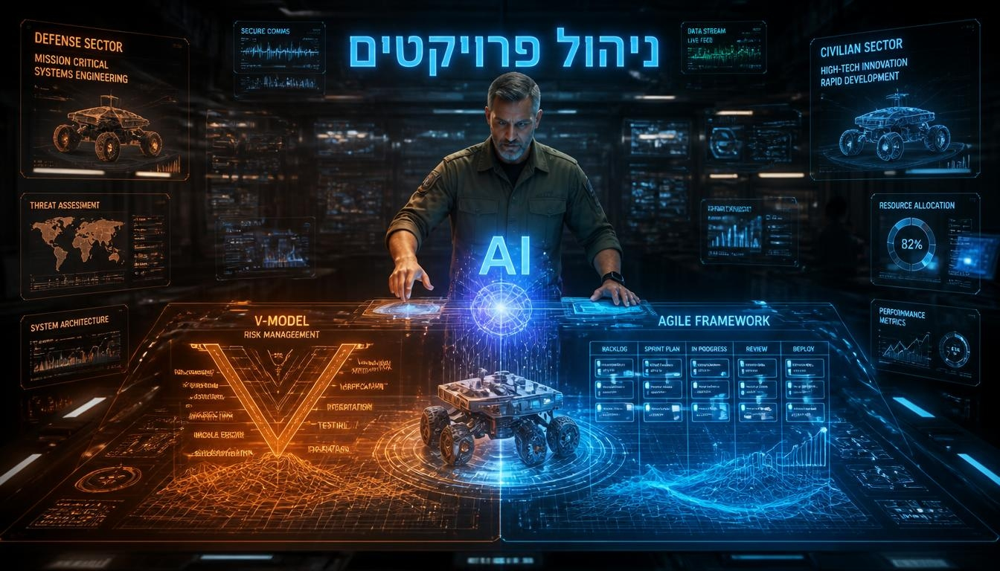

# ofirhaim212-commits.github.io
<!DOCTYPE html>
<html lang="he" dir="rtl">
<head>
    <meta charset="UTF-8">
    <meta name="viewport" content="width=device-width, initial-scale=1.0">
    <title>מערכת הנדסית היברידית | יועץ מומחה</title>
    
    <link href="https://fonts.googleapis.com/css2?family=Rubik:wght@300;400;500;700&display=swap" rel="stylesheet">
    
    
</head>
<body class="antialiased min-h-screen flex flex-col relative overflow-x-hidden">

    <!-- Background Decoration -->
    

        

        

    

    <!-- Header -->
    <header class="relative z-10 glass-panel border-b border-slate-700/50 py-4">
        

            

                הנדסת מערכות 2.0
            

            <nav class="hidden md:flex space-x-reverse space-x-6 text-sm font-medium text-slate-300">
                <a href="#methodology" class="hover:text-cyan-400 transition-colors">המתודולוגיה</a>
                <a href="#lifecycle" class="hover:text-cyan-400 transition-colors">מחזור חיים</a>
                <a href="#cta" class="hover:text-cyan-400 transition-colors">משאבים</a>
                <a href="#contact" class="hover:text-cyan-400 transition-colors">צור קשר</a>
            </nav>
        

    </header>

    <!-- Hero Section -->
    <section class="relative z-10 flex-grow flex items-center py-20">
        

            

                <!-- Text Content -->
                

                    

                        ייעוץ אסטרטגי וניהול פרויקטים
                    

                    <h1 class="text-4xl md:text-5xl lg:text-6xl font-bold leading-tight mb-6">
                        ניהול פרויקטים והנדסת מערכת  
                        בשילוב AI
                    </h1>
                    

                        הגשר בין משמעת צבאית קפדנית למהירות פיתוח אזרחית. שימוש בבינה מלאכותית כמכפיל כוח משלב הדרישות ועד הייצור.
                    

                    <a href="#contact" class="px-8 py-3 bg-gradient-to-r from-cyan-600 to-blue-600 hover:from-cyan-500 hover:to-blue-500 text-white font-medium rounded-lg shadow-lg hover:shadow-cyan-500/25 transition-all duration-300">
                        התחל עכשיו
                    </a>
                

                
                <!-- Hero Image -->
                

                    

                    
                

            

        

    </section>

    <!-- Methodology Section -->
    <section id="methodology" class="relative z-10 py-20 bg-slate-900/50">
        

            

                <h2 class="text-3xl md:text-4xl font-bold mb-4">המתודולוגיה ההיברידית</h2>
                
מעבר חכם מסביבה קשיחה לסביבה גמישה, תוך שמירה על בקרת איכות קפדנית.

            

            

                <!-- Connection Line (Desktop) -->
                

                <!-- Step 1: Military -->
                

                    

                        <svg class="w-8 h-8" fill="none" stroke="currentColor" viewBox="0 0 24 24"><path stroke-linecap="round" stroke-linejoin="round" stroke-width="2" d="M9 12l2 2 4-4m5.618-4.016A11.955 11.955 0 0112 2.944a11.955 11.955 0 01-8.618 3.04A12.02 12.02 0 003 9c0 5.591 3.824 10.29 9 11.622 5.176-1.332 9-6.03 9-11.622 0-1.042-.133-2.052-.382-3.016z"></path></svg>
                    

                    <h3 class="text-xl font-bold mb-3 text-orange-400">סביבה צבאית</h3>
                    

                        תהליך טורי, קשיח עם אוריינטציה לאפס תקלות. מיקוד בניהול סיכונים הרמטי ועמידה בתקנים מחמירים (MIL-STD).
                    

                

                <!-- Step 2: AI Copilot -->
                

                    

                        <svg class="w-10 h-10" fill="none" stroke="currentColor" viewBox="0 0 24 24"><path stroke-linecap="round" stroke-linejoin="round" stroke-width="1.5" d="M9.75 17L9 20l-1 1h8l-1-1-.75-3M3 13h18M5 17h14a2 2 0 002-2V5a2 2 0 00-2-2H5a2 2 0 00-2 2v10a2 2 0 002 2z"></path></svg>
                    

                    <h3 class="text-2xl font-bold mb-3 text-cyan-400">ה-AI כטייס משנה</h3>
                    

                        ייעול סקרי תכן. ה-AI מצליב נתונים, מזהה אנומליות ומציף קונפליקטים, בעוד <strong class="text-white">המהנדס מקבל את ההחלטה האסטרטגית</strong>.
                    

                

                <!-- Step 3: Civilian Agile -->
                

                    

                        <svg class="w-8 h-8" fill="none" stroke="currentColor" viewBox="0 0 24 24"><path stroke-linecap="round" stroke-linejoin="round" stroke-width="2" d="M13 10V3L4 14h7v7l9-11h-7z"></path></svg>
                    

                    <h3 class="text-xl font-bold mb-3 text-blue-400">סביבה אזרחית</h3>
                    

                        פיתוח גמיש (Agile), מהיר ואיטרטיבי. התמקדות באופטימיזציה של החזר השקעה (ROI) וקיצור זמן ההגעה לשוק.
                    

                

            

        

    </section>

    <!-- Lifecycle Phases Section -->
    <section id="lifecycle" class="relative z-10 py-20">
        

            

                <h2 class="text-3xl md:text-4xl font-bold mb-4">מחזור חיים הנדסי מועצם AI</h2>
                
שילוב כלי בינה מלאכותית בכל שלב בפרויקט להאצת פיתוח ומניעת כשלים.

            

            

                <!-- Phase 1 -->
                

                    
01

                    <h3 class="text-xl font-bold mb-4 text-white">זיהוי צורך והנדסת דרישות</h3>
                    <ul class="text-slate-300 space-y-2 text-sm">
                        <li class="flex items-start gap-2">
                            <svg class="w-5 h-5 text-cyan-400 shrink-0" fill="none" stroke="currentColor" viewBox="0 0 24 24"><path stroke-linecap="round" stroke-linejoin="round" stroke-width="2" d="M5 13l4 4L19 7"></path></svg>
                            ניתוח מכרזים ו-SOW בעזרת LLM
                        </li>
                        <li class="flex items-start gap-2">
                            <svg class="w-5 h-5 text-cyan-400 shrink-0" fill="none" stroke="currentColor" viewBox="0 0 24 24"><path stroke-linecap="round" stroke-linejoin="round" stroke-width="2" d="M5 13l4 4L19 7"></path></svg>
                            חילוץ דרישות אוטומטי (SRD)
                        </li>
                        <li class="flex items-start gap-2">
                            <svg class="w-5 h-5 text-cyan-400 shrink-0" fill="none" stroke="currentColor" viewBox="0 0 24 24"><path stroke-linecap="round" stroke-linejoin="round" stroke-width="2" d="M5 13l4 4L19 7"></path></svg>
                            זיהוי פערים (Gaps) וסתירות לוגיות
                        </li>
                    </ul>
                

                <!-- Phase 2 -->
                

                    
02

                    <h3 class="text-xl font-bold mb-4 text-white">סקרי תכן וארכיטקטורה</h3>
                    <ul class="text-slate-300 space-y-2 text-sm">
                        <li class="flex items-start gap-2">
                            <svg class="w-5 h-5 text-blue-400 shrink-0" fill="none" stroke="currentColor" viewBox="0 0 24 24"><path stroke-linecap="round" stroke-linejoin="round" stroke-width="2" d="M5 13l4 4L19 7"></path></svg>
                            ייעול סקרי PDR/CDR
                        </li>
                        <li class="flex items-start gap-2">
                            <svg class="w-5 h-5 text-blue-400 shrink-0" fill="none" stroke="currentColor" viewBox="0 0 24 24"><path stroke-linecap="round" stroke-linejoin="round" stroke-width="2" d="M5 13l4 4L19 7"></path></svg>
                            תכן גנרטיבי לחלופות פיזיקליות
                        </li>
                        <li class="flex items-start gap-2">
                            <svg class="w-5 h-5 text-blue-400 shrink-0" fill="none" stroke="currentColor" viewBox="0 0 24 24"><path stroke-linecap="round" stroke-linejoin="round" stroke-width="2" d="M5 13l4 4L19 7"></path></svg>
                            מודלים הנדסיים מונחי AI (MBSE)
                        </li>
                    </ul>
                

                <!-- Phase 3 -->
                

                    
03

                    <h3 class="text-xl font-bold mb-4 text-white">פיתוח ואינטגרציה</h3>
                    <ul class="text-slate-300 space-y-2 text-sm">
                        <li class="flex items-start gap-2">
                            <svg class="w-5 h-5 text-indigo-400 shrink-0" fill="none" stroke="currentColor" viewBox="0 0 24 24"><path stroke-linecap="round" stroke-linejoin="round" stroke-width="2" d="M5 13l4 4L19 7"></path></svg>
                            מניעת עיכובים בנתיב הקריטי בזמן אמת
                        </li>
                        <li class="flex items-start gap-2">
                            <svg class="w-5 h-5 text-indigo-400 shrink-0" fill="none" stroke="currentColor" viewBox="0 0 24 24"><path stroke-linecap="round" stroke-linejoin="round" stroke-width="2" d="M5 13l4 4L19 7"></path></svg>
                            בקרת סטטוס חכמה וסנכרון צוותים
                        </li>
                        <li class="flex items-start gap-2">
                            <svg class="w-5 h-5 text-indigo-400 shrink-0" fill="none" stroke="currentColor" viewBox="0 0 24 24"><path stroke-linecap="round" stroke-linejoin="round" stroke-width="2" d="M5 13l4 4L19 7"></path></svg>
                            אוטומציית אימות (V&V) וגזירת בדיקות
                        </li>
                    </ul>
                

                <!-- Phase 4 -->
                

                    
04

                    <h3 class="text-xl font-bold mb-4 text-white">העברה לייצור ותיקוף</h3>
                    <ul class="text-slate-300 space-y-2 text-sm">
                        <li class="flex items-start gap-2">
                            <svg class="w-5 h-5 text-purple-400 shrink-0" fill="none" stroke="currentColor" viewBox="0 0 24 24"><path stroke-linecap="round" stroke-linejoin="round" stroke-width="2" d="M5 13l4 4L19 7"></path></svg>
                            בקרת תצורה חכמה (Design Freeze)
                        </li>
                        <li class="flex items-start gap-2">
                            <svg class="w-5 h-5 text-purple-400 shrink-0" fill="none" stroke="currentColor" viewBox="0 0 24 24"><path stroke-linecap="round" stroke-linejoin="round" stroke-width="2" d="M5 13l4 4L19 7"></path></svg>
                            זיהוי חוסרי רכיבים טרם ייצור ב-BOM
                        </li>
                        <li class="flex items-start gap-2">
                            <svg class="w-5 h-5 text-purple-400 shrink-0" fill="none" stroke="currentColor" viewBox="0 0 24 24"><path stroke-linecap="round" stroke-linejoin="round" stroke-width="2" d="M5 13l4 4L19 7"></path></svg>
                            בקרת איכות ויזואלית (Vision AI)
                        </li>
                    </ul>
                

            

        

    </section>

    <!-- CTA Section -->
    <section id="cta" class="relative z-10 py-16 bg-slate-900/50">
        

            

                

                <h2 class="text-3xl font-bold mb-4">מוכנים לצלול לעומק?</h2>
                

                    הורידו את המצגת המלאה המפרטת את ארבעת שלבי היישום של בינה מלאכותית בהנדסת מערכות וניהול פרויקטים, משלב הדרישות ועד העברה לייצור.
                

                <a href="ניהול פרויקטים והנדסת מערכת בשילוב AI.pdf" target="_blank" class="inline-flex items-center gap-2 px-8 py-4 bg-white text-slate-900 font-bold rounded-lg hover:bg-slate-200 transition-colors shadow-[0_0_20px_rgba(255,255,255,0.3)]">
                    <svg class="w-6 h-6" fill="none" stroke="currentColor" viewBox="0 0 24 24"><path stroke-linecap="round" stroke-linejoin="round" stroke-width="2" d="M12 10v6m0 0l-3-3m3 3l3-3m2 8H7a2 2 0 01-2-2V5a2 2 0 012-2h5.586a1 1 0 01.707.293l5.414 5.414a1 1 0 01.293.707V19a2 2 0 01-2 2z"></path></svg>
                    לצפייה במצגת המלאה
                </a>
            

        

    </section>

    <!-- Contact Form Section -->
    <section id="contact" class="relative z-10 py-20">
        

            

                

                    <h2 class="text-3xl font-bold mb-4 text-white">השארת פרטים</h2>
                    
תנו לנו לסייע לכם למנף את הפרויקט הבא באמצעות כלים חכמים והכוונה מדויקת.

                

                
                <form class="space-y-6">
                    

                        

                            <label for="fullName" class="block text-sm font-medium text-slate-300">שם מלא</label>
                            <input type="text" id="fullName" class="w-full bg-slate-900/80 border border-slate-600 rounded-lg px-4 py-3 text-white focus:outline-none focus:border-cyan-500 focus:ring-1 focus:ring-cyan-500 transition-all" placeholder="הכנס שם מלא" required>
                        

                        

                            <label for="email" class="block text-sm font-medium text-slate-300">דוא"ל</label>
                            <input type="email" id="email" class="w-full bg-slate-900/80 border border-slate-600 rounded-lg px-4 py-3 text-white focus:outline-none focus:border-cyan-500 focus:ring-1 focus:ring-cyan-500 transition-all" placeholder="you@company.com" required>
                        

                    

                    
                    

                        <label for="projectPhase" class="block text-sm font-medium text-slate-300">שלב נוכחי בפרויקט</label>
                        <select id="projectPhase" class="w-full bg-slate-900/80 border border-slate-600 rounded-lg px-4 py-3 text-white focus:outline-none focus:border-cyan-500 focus:ring-1 focus:ring-cyan-500 transition-all appearance-none" required>
                            <option value="" disabled selected>בחר שלב בפרויקט...</option>
                            <option value="initiation">שלב א': זיהוי צורך והנדסת דרישות</option>
                            <option value="design">שלב ב': סקרי תכן וארכיטקטורה (PDR/CDR)</option>
                            <option value="execution">שלב ג': פיתוח, ניהול משימות ואינטגרציה</option>
                            <option value="production">שלב ד': העברה לייצור ותיקוף</option>
                        </select>
                    

                    

                        <label for="challenge" class="block text-sm font-medium text-slate-300">האתגר המרכזי</label>
                        <textarea id="challenge" rows="4" class="w-full bg-slate-900/80 border border-slate-600 rounded-lg px-4 py-3 text-white focus:outline-none focus:border-cyan-500 focus:ring-1 focus:ring-cyan-500 transition-all resize-none" placeholder="תאר את צוואר הבקבוק או האתגר המרכזי שאתה חווה..." required></textarea>
                    

                    <button type="submit" class="w-full py-4 bg-gradient-to-r from-cyan-600 to-blue-600 hover:from-cyan-500 hover:to-blue-500 text-white font-bold rounded-lg shadow-lg hover:shadow-cyan-500/25 transition-all duration-300">
                        שלח פנייה
                    </button>
                </form>
            

        

    </section>

    <!-- Chatbot Widget -->
    

        <!-- Chat Window -->
        

            <!-- Chat Header -->
            

                

                    

                        <svg class="w-5 h-5 text-white" fill="none" stroke="currentColor" viewBox="0 0 24 24"><path stroke-linecap="round" stroke-linejoin="round" stroke-width="2" d="M9.75 17L9 20l-1 1h8l-1-1-.75-3M3 13h18M5 17h14a2 2 0 002-2V5a2 2 0 00-2-2H5a2 2 0 00-2 2v10a2 2 0 002 2z"></path></svg>
                    

                    

                        <h4 class="font-bold text-sm text-cyan-50">מהנדס מערכת AI</h4>
                         מחובר
                    

                

                <button onclick="toggleChat()" class="text-slate-400 hover:text-white transition-colors">
                    <svg class="w-6 h-6" fill="none" stroke="currentColor" viewBox="0 0 24 24"><path stroke-linecap="round" stroke-linejoin="round" stroke-width="2" d="M6 18L18 6M6 6l12 12"></path></svg>
                </button>
            

            
            <!-- Chat Messages -->
            

                <!-- Initial Message will be injected here -->
            

            
            <!-- Typing Indicator (Hidden by default) -->
            

                

                    

                    

                    

                

            

            <!-- Chat Input -->
            

                <form id="chat-form" class="flex gap-2 relative">
                    <input type="text" id="chat-input" placeholder="הקלד הודעה..." 
                           class="flex-1 bg-slate-900 text-sm text-white placeholder-slate-400 rounded-full py-2 px-4 border border-slate-600 focus:outline-none focus:border-cyan-500 focus:ring-1 focus:ring-cyan-500 transition-all">
                    <button type="submit" id="send-btn" class="w-10 h-10 rounded-full bg-gradient-to-r from-cyan-600 to-blue-600 flex items-center justify-center text-white hover:shadow-[0_0_10px_rgba(6,182,212,0.5)] transition-all disabled:opacity-50">
                        <svg class="w-5 h-5 transform -rotate-90 ml-1" fill="none" stroke="currentColor" viewBox="0 0 24 24"><path stroke-linecap="round" stroke-linejoin="round" stroke-width="2" d="M12 19l9 2-9-18-9 18 9-2zm0 0v-8"></path></svg>
                    </button>
                </form>
            

        

        <!-- Chat Toggle Button -->
        <button onclick="toggleChat()" id="chat-toggle-btn" class="w-14 h-14 rounded-full bg-gradient-to-r from-cyan-600 to-blue-600 text-white shadow-[0_0_20px_rgba(6,182,212,0.4)] flex items-center justify-center hover:scale-110 transition-transform">
            <svg class="w-7 h-7" fill="none" stroke="currentColor" viewBox="0 0 24 24"><path stroke-linecap="round" stroke-linejoin="round" stroke-width="2" d="M8 10h.01M12 10h.01M16 10h.01M9 16H5a2 2 0 01-2-2V6a2 2 0 012-2h14a2 2 0 012 2v8a2 2 0 01-2 2h-5l-5 5v-5z"></path></svg>
        </button>
    

    
</body>
</html>
